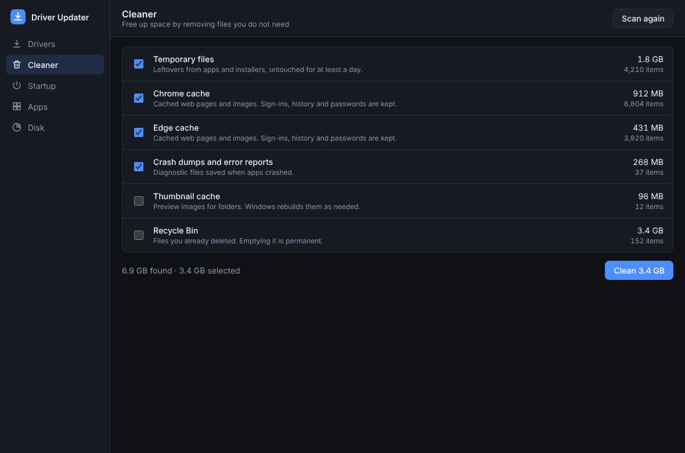

# Driver Updater

A Windows desktop app that keeps a PC in shape: it finds and installs driver
updates, clears out junk files, manages what starts with Windows, lists and
removes installed apps, and shows what is filling the disk. Rust backend,
Tauri 2 + React interface.




*Screenshots use sample data.*

## What it does

**Drivers**

- Inventories every installed driver: device, provider, version, date, signer,
  INF and hardware ID.
- Asks Windows Update what is newer, including the optional driver updates
  Windows tucks away in Settings. Each offer is matched to the installed driver
  by hardware ID and only shown as an update if it is actually newer.
- Installs the updates you choose. Windows asks for administrator permission,
  the app tries to create a restore point, then downloads and installs through
  Windows Update, so every driver is the same Microsoft-signed package Windows
  itself would install.
- Flags old graphics, network, audio, chipset and storage drivers where the
  vendor likely has something newer, with a link to the vendor's official
  download page, and surfaces devices with missing drivers or errors.
- Exports the report as CSV or JSON.

**Cleaner**

- Measures and removes temporary files, browser caches (Chrome, Edge, Brave,
  Firefox), crash dumps and error reports, the thumbnail cache and the Recycle
  Bin. You choose the categories and confirm before anything is deleted.
- Browser sign-ins, history and passwords are never touched; only caches.
- Files in use are left alone, and temporary files newer than a day are kept.

**Startup**

- Lists what launches when you sign in and lets you switch each item off or
  back on. It uses the same switch as Task Manager, so nothing is deleted.

**Apps**

- Lists installed programs with version, install date and size, and opens a
  program's own uninstaller on request.

**Disk**

- Shows which folders and files take the most space in your user folder, or
  any folder you pick, with a shortcut to show each in Explorer. Read-only.

Only installing drivers asks for administrator rights. There is deliberately
no registry cleaner and no drive wiper: the first does more harm than good,
and the second is too easy to regret.

The app also tells you when a new version of itself is out.

## Download

**[Download the latest release](https://github.com/ryanrusson/windows-driver-updater/releases/latest)**
and run the `.exe` under Assets.

The installer is not code-signed yet, so Windows SmartScreen will warn the
first time: choose **More info → Run anyway**. It installs everything the app
needs (the WebView2 runtime is downloaded if your PC does not have it).

## Release

Bump the version in `src-tauri/tauri.conf.json`, `src-tauri/Cargo.toml` and
`package.json`, and merge to `main`. The **Release** workflow sees a version
that has not been released, builds the installer and publishes a GitHub
Release with it attached. Merges that do not change the version publish
nothing.

## Develop

Requires [Rust](https://rustup.rs), Node 22+ and, on Windows, the
[Tauri prerequisites](https://tauri.app/start/prerequisites/).

```sh
npm install
npm run tauri dev      # run the app (Windows)
npm run tauri build    # build the installer (Windows)
npm run dev            # UI only, in a browser, on sample data (any OS)
cargo test -p driver-core -p system-tools
cargo run -p driver-core --bin driver-scan   # scan from the command line, as JSON (Windows)
```

## Layout

| Path | What |
| --- | --- |
| `crates/system-tools` | Cleaner, startup manager, installed apps and disk usage. Deletion rules and parsing are plain Rust with tests; registry and shell calls are confined to small Windows-only parts. |
| `crates/driver-core` | The driver logic. `platform/` talks to Windows (WMI for the inventory, the Windows Update Agent API to find and install updates, and the elevated install helper); the rest is plain Rust with tests that run on any OS. |
| `src-tauri` | The Tauri shell: a handful of commands exposing the two crates to the UI. |
| `src` | The React interface. |
