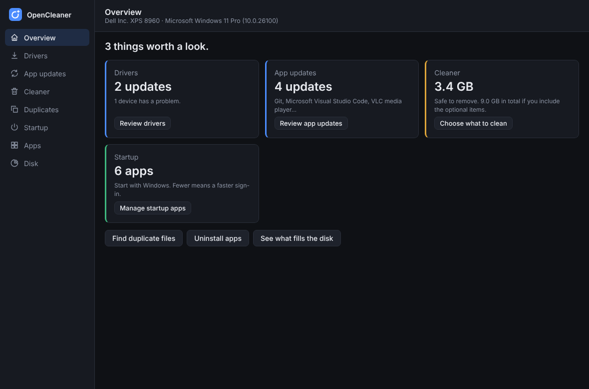

# Driver Updater

A Windows desktop app that scans the drivers installed on your PC and tells you
which ones have updates. Rust backend, Tauri 2 + React interface.



*Screenshot uses sample data.*

## What it does

- **Inventories every installed driver**: device, provider, version, date, signer, INF and hardware ID.
- **Asks Windows Update what is newer**, including the optional driver updates
  Windows tucks away in Settings. Each offer is matched to the installed driver
  by hardware ID and only shown as an update if it is actually newer.
- **Flags drivers worth checking by hand**: old graphics, network, audio, chipset
  and storage drivers where the vendor (NVIDIA, AMD, Intel, or your PC maker)
  likely has something newer than Windows Update. It links to the vendor's
  official download page; nothing is scraped or downloaded from third parties.
- **Surfaces problem devices**: missing drivers and Device Manager error codes.
- **Exports** the report as CSV or JSON.

- **Installs the updates you choose**, one click each or all at once. Windows
  asks for administrator permission, the app tries to create a restore point,
  then downloads and installs through Windows Update, so every driver is the
  same Microsoft-signed package Windows itself would install.

Scanning needs no administrator rights and changes nothing. Only installing
asks for elevation, and only for the updates you confirmed.

## Download

**[Download the latest release](https://github.com/ryanrusson/windows-driver-updater/releases/latest)**
and run the `.exe` under Assets.

The installer is not code-signed yet, so Windows SmartScreen will warn the
first time: choose **More info → Run anyway**. It installs everything the app
needs (the WebView2 runtime is downloaded if your PC does not have it).

## Release

Bump the version in `src-tauri/tauri.conf.json`, `src-tauri/Cargo.toml` and
`package.json`, and merge to `main`. The **Release** workflow sees a version
that has not been released, builds the installer and publishes a GitHub
Release with it attached. Merges that do not change the version publish
nothing.

## Develop

Requires [Rust](https://rustup.rs), Node 22+ and, on Windows, the
[Tauri prerequisites](https://tauri.app/start/prerequisites/).

```sh
npm install
npm run tauri dev      # run the app (Windows)
npm run tauri build    # build the installer (Windows)
npm run dev            # UI only, in a browser, on sample data (any OS)
cargo test -p driver-core
cargo run -p driver-core --bin driver-scan   # scan from the command line, as JSON (Windows)
```

## Layout

| Path | What |
| --- | --- |
| `crates/driver-core` | All the logic. `platform/` talks to Windows (WMI for the inventory, the Windows Update Agent API to find and install updates, and the elevated install helper); the rest is plain Rust with tests that run on any OS. |
| `src-tauri` | The Tauri shell: a handful of commands exposing `driver-core` to the UI. |
| `src` | The React interface. |
